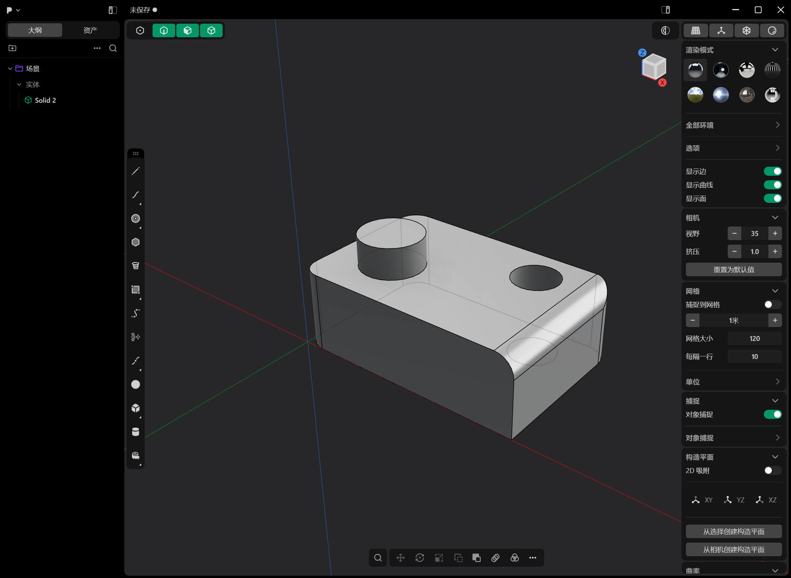

# dsh-plasticity-plugin

> DeepSeek Harness（DSH）× **Plasticity 3D** 直连插件：让 AI 直接在你的 Plasticity 里做原生 CAD 建模。
> 自建 Electron CDP 桥，不 patch 磁盘文件、不重签名；所有写操作走 Plasticity 自己的命令管线（**可 Undo**）。
> 单位全部 **mm**，几何是真正的 Parasolid B-rep（不是网格近似）。



```
AI (DSH) ──tools──▶ 插件 (Node) ──loopback CDP 127.0.0.1:9223──▶ Plasticity 渲染进程
                                                              └─ editor.commands / *Factory / commit()
```

## 功能

- **读**：场景快照（body id / 名称 / bbox / face & edge id + 拓扑摘要）、原生 B-rep 测量（体积 mm³、表面积 mm²、包围盒、native 校验码）
- **建**：box / cylinder / sphere；面拉伸、闭合轮廓拉伸（自动生成原生 region）
- **改**：布尔（union / difference / intersection）、圆角 / 倒角、平移 / 绕轴旋转 / 缩放、删除、undo / redo
- **出**：STEP / STL / 3MF / OBJ；相机取景（iso/front/top…）+ 视口截图
- **兜底**：`plasticity_script` 在 Plasticity 渲染进程里执行 JS（带 `editor` / `api` / `find` 等预置）

## 环境要求

| 项 | 要求 |
|---|---|
| 系统 | Windows 10/11 x64（当前实测平台） |
| Plasticity | **26.1.3**（命令/工厂名按此版本锁定；`EnableNodeCliInspectArguments` fuse 必须为开启） |
| DSH | `>= 0.1.0-rc.7`（插件 bundle 机制） |
| Node | `>= 22`（仅打包/测试用；插件运行时由 DSH 提供） |

## 安装

推荐用 **tarball 安装**（pnpm 解包成真实目录，不产生 Windows junction，最稳）：

```powershell
# 1) 打包（读 package.json version，按 files 收集）
npm run pack          # 产物：<outdir>/dsh-plasticity-plugin-<ver>.tgz

# 2) 在 DSH 里安装 bundle（会写 profile 的 dependencies，并保留 dsh.profile.bundles）
#    plugin_manager install_bundle target=".../dsh-plasticity-plugin-<ver>.tgz"

# 3) 完全退出并重开 DSH Desktop；启动日志应出现：
#    [dsh-plasticity-plugin] v0.2.0 registered 16 tools
```

也支持从 GitHub 安装（需 DSH 的插件管理器支持 git 源）：

```
# plugin_manager install_bundle target="https://github.com/EEEtPn/dsh-plasticity-plugin"
```

细节（含手动开发安装、回滚、卸载）见 [docs/INSTALL.md](docs/INSTALL.md)。

## 快速开始

```
1. plasticity_status                      # 看桥是否连上、当前场景
2. plasticity_launch                      # 没连上就启动（isolated:true = 临时实例，不动你正在编辑的文档）
3. plasticity_scene                       # 读 body id / 拓扑
4. plasticity_create / extrude / boolean / fillet / transform
5. plasticity_measure                     # 体积 / 面积 / 包围盒 / native 校验
6. plasticity_view → plasticity_screenshot # 取景后截图
7. plasticity_export {format:"step"}      # 出 STEP 给 SolidWorks / Fusion / 切片器
```

一句话示例：*「做一个 60×40×20 的板，右后方开 Ø12 通孔，左前方加 Ø16×8 凸台，四角 R5，导 STEP」* ——
AI 会依次调用 create / boolean / fillet / export，并在需要时截图确认。

## 工具一览（16 个）

| 工具 | 作用 |
|---|---|
| `plasticity_status` | 连接状态 + 场景摘要（先调它） |
| `plasticity_launch` | 带回环调试端口启动 Plasticity（`isolated:true` 临时实例 / `false` 驱动你自己的窗口） |
| `plasticity_scene` | 场景快照：body / bbox(mm) / face & edge id（含拓扑摘要） |
| `plasticity_measure` | 原生 B-rep 测量：体积 mm³、表面积 mm²、包围盒、native 校验码 |
| `plasticity_create` | box / cylinder / sphere |
| `plasticity_extrude` | 面拉伸（bodyId+faceIds）或闭合轮廓拉伸（pointsMm → 原生 region） |
| `plasticity_boolean` | union / difference / intersection（可 keepTools） |
| `plasticity_fillet` | 圆角 / 倒角（chamfer=true） |
| `plasticity_transform` | 平移 / 绕轴旋转 / 缩放 |
| `plasticity_delete` | 删除 body（可 Undo） |
| `plasticity_history` | undo / redo |
| `plasticity_export` | STEP / STL / 3MF / OBJ |
| `plasticity_view` | 相机预设 / 显式 from-target / 按包围盒自动取景 |
| `plasticity_screenshot` | 视口 PNG（先关掉半开的工具弹窗再截） |
| `plasticity_shutdown` | 关掉插件启动的实例并断开桥 |
| `plasticity_script` | 在 renderer 执行 JS 的 escape hatch |

参数与返回结构见 [docs/TOOLS.md](docs/TOOLS.md)；实现原理见 [docs/ARCHITECTURE.md](docs/ARCHITECTURE.md)。

## 单位与坐标约定

- 工具边界一律 **mm / 度**；Plasticity 内部是米（页面端 `toM()` 换算）。
- `box`：`originMm` 是角点，`sizeMm` 是三边长度。
- `cylinder`：`centerMm` 是**底面圆心**，`heightMm` 沿 `axis`（默认 +Z）。
- `sphere`：`centerMm` 是球心。
- `extrude` 轮廓模式：点在 XY 平面（`planeZMm` 指定高度），自动补成逆时针闭环（Plasticity 只对闭合 CCW loop 生成 region）。
- `plasticity_export` 相对路径按**会话工作区**解析；截图落在 `<workspace>/.dsh-plasticity/shots/`。

## 安全说明

- CDP 只监听 **127.0.0.1**（回环），不接受外部连接；不要改成 `0.0.0.0`。
- `plasticity_script` 能在 Plasticity 渲染进程执行任意 JS —— 只在你信任的会话里使用。
- 插件不会修改 Plasticity 安装目录或注册表；`--inspect-brk` 只在启动时用于注入回环调试端口。

## 已知限制

- **版本绑定 26.1.3**：Plasticity 升级到 26.2+ 后命令/工厂名可能变化，需要更新 `lib/ops.js` 的候选名表与 `lib/session.js` 的 discovery 谓词。
- **体积质心**（center of mass）暂未提供：需要 Parasolid kernel 命名空间，本机存在双候选，插件主动绕开。
- **单实例锁**：驱动你正在使用的窗口前必须先退出 Plasticity；实验请用 `isolated:true`。
- **共享恢复文档**：Plasticity 把崩溃恢复副本写到固定 `%TEMP%\plasticity\backup.production.plasticity`（`--user-data-dir` 不覆盖）。
  `isolated:true` 会使用私有 TEMP + 启动前快照，避免影响你自己的会话。

## 开发

```bash
npm test      # 无需 Plasticity：mock 宿主校验 16 个工具注册、schema、状态工具
npm run pack  # 打 npm 兼容 tarball
npm run verify# 需要本机 Plasticity：起隔离实例跑一遍烟雾（launch/scene/create/measure/export）
```

目录：

```
lib/protocol.js   CDP 客户端 + Plasticity 启动器（--inspect-brk、主进程补丁、等 page target）
lib/session.js    Editor 发现、按名字解析 Factory/Vector/Quaternion、bootstrap shim
lib/ops.js        CAD 操作（页面端 JS 体；移植自 community plasticity-mcp, MIT，已适配扁平 store）
lib/index.js      16 个 defineTool + 结果消毒（lossless JSON）+ 串行队列 + 相机/截图/关闭
test/             mock 宿主测试（node:test）
scripts/          pack / verify
docs/             安装、架构、工具参考、故障排查
```

## 致谢

渲染进程内的命令/工厂调用模式参考了 MIT 项目 [plasticity-mcp](https://github.com/Mesteriis/plasticity-mcp)，
并按 Windows 版 26.1.3 的扁平 store 与「按名字解析工厂」方案重写。

## License

[MIT](LICENSE)
